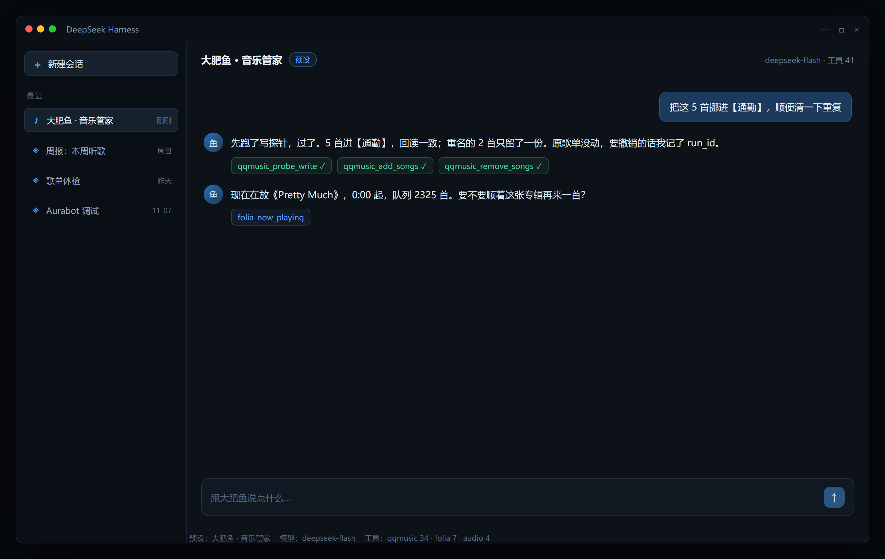
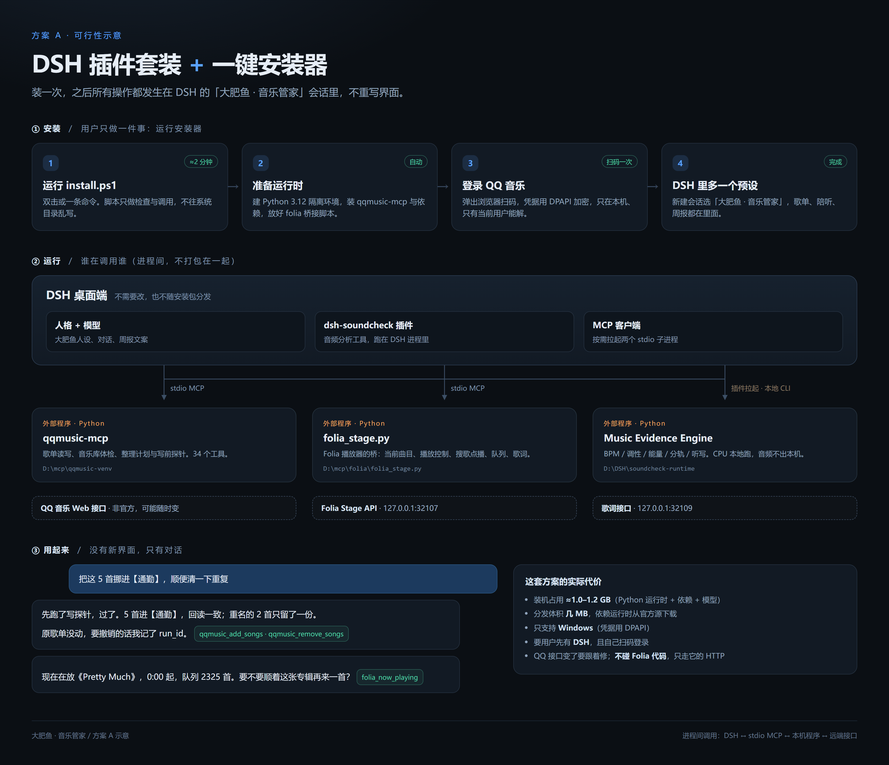

# 效果展示

大肥鱼没有独立界面——它就在 DSH 的会话里。下面这些图是**界面方案效果图**（设计阶段画的），
不是运行截图：用它说明"用起来是什么感觉"和"这套东西是怎么装起来的"。

---

## 在 DSH 里：只有对话

右上角是你说的，鱼头是它回的。注意三条：

1. 它先说**做了什么**（"先跑了写探针，过了"），再说结果（"5 首进【通勤】，回读一致"）；
2. 工具调用带勾：`qqmusic_probe_write ✓` `qqmusic_add_songs ✓` `qqmusic_remove_songs ✓`——
   每步都能被看见，不是黑箱；
3. **主动交代回滚**（"原歌单没动，要撤销的话我记了 run_id"），并顺手把下一件事递上来
   （"现在在放《Pretty Much》，要不要顺着这张专辑再来一首"）。

底部一行是装备：`预设：大肥鱼 · 音乐管家  模型：deepseek-flash  工具：qqmusic 34 · folia 7 · audio 4`。

## 装起来是什么结构

一次安装，四步：跑 `install.ps1` → 准备隔离运行时（Python 3.12 + qqmusic-mcp + Folia 桥）→
扫一次码登录 QQ 音乐 → DSH 里多一个 preset。

进程间不是打包在一起，而是 DSH 通过 **stdio MCP** 拉起三个外部程序：

| 外部程序 | 干什么 | 端口 |
|---|---|---|
| `qqmusic-mcp` | 歌单读写、体检、整理计划与写前探针（34 个工具） | — |
| `folia_stage.py` | 当前曲目、播放控制、搜索点播、队列、歌词 | `127.0.0.1:32107` / 歌词 `32109` |
| Music Evidence Engine | BPM / 调性 / 能量 / 分段 / 听写，CPU 本地跑 | — |

代价写在图右下角：装机 1.0–1.2 GB、只支持 Windows（DPAPI）、要用户先有 DSH 并自己扫码。

## 另外两套界面方案

| 方案 | 思路 | 图 |
|---|---|---|
| B | 管家做成 DSH 内的可折叠侧栏，对话与歌单列表并排 | `assets/mock-b.png` |
| C | 对话为主，歌单操作以卡片形式插在对话流里 | `assets/mock-c.png` |

最后选的是 A：**不重写界面，所有操作都发生在「大肥鱼 · 音乐管家」会话里**。
理由是这套东西的价值在"你一句话它就把脏活干了"，多一层界面只是多一层要维护的东西。

## 它的实际能力

- 20 个歌单 / 2325 首喜欢的账号，全量可读
- 歌单整理走「探针 · 限速 · 断点 · run_id 回滚」，出问题能回退
- 每周听歌报告：本周概览 / TOP5 / 曲风分布 / 情绪走向 / 歌单优化建议
- 陪听时能读 Folia 的实时状态，知道你在听第几秒

## 和另外两个项目的关系

- **大肥鱼音乐管家**（[dafeiyu-yinyueguanjia](https://github.com/gyc0717/dafeiyu-yinyueguanjia)）：
  自研独立软件版，播放器为主、管家为辅。本 preset 是它的参考实现——两条线共用同一套 provider 逻辑，
  这个 preset 验证过所有接口，独立版直接移植。
- **记忆星海**（[jiyixinghai](https://github.com/gyc0717/jiyixinghai)）：另一个 DSH 插件，把聊天记录摊成 3D 星海。

> 想装上用，翻 [使用说明.md](使用说明.md)；想知道为什么这么设计，看
> [大肥鱼音乐管家-蓝图](https://github.com/gyc0717/dafeiyu-yinyueguanjia) 里的 `04_交接/HANDOFF.md`。
